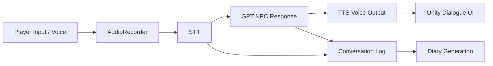

# 도란도란 · Metaverse 2024

AI NPC와 STT/GPT/TTS 기반 대화 흐름을 Unity 클라이언트 안에서 하나의 사용자 경험으로 연결한 메타버스 프로젝트입니다.

## Portfolio Summary

- **프로젝트명**: 도란도란
- **대회**: 2024 메타버스 개발자 경진대회
- **팀명**: AI THEN TTS
- **담당 역할**: 팀장 / 개발 총괄 / AI 인격체 구현 / API 연동
- **주요 기술**: Unity 2023.2.20f1, C#, GPT-4 turbo 기반 대화 AI, STT, TTS, Custom API Integration
- **시연 영상**: [YouTube](https://youtu.be/Wyi0KtXQfa8)

## 제가 담당한 부분

- Unity 클라이언트 안에서 AI NPC 대화, TTS 음성 출력, 대화 로그 기반 다이어리 기능이 하나의 경험으로 이어지도록 흐름을 구성했습니다.
- 사용자의 음성 입력을 STT로 변환하고, 현재 NPC의 성격 프롬프트를 기준으로 GPT 응답을 생성한 뒤, TTS를 통해 음성으로 출력하는 연결부를 담당했습니다.
- 팀장으로서 AI/API/클라이언트/디자인/사운드 작업 범위를 발표 가능한 결과물 형태로 조율했습니다.

## 시스템 흐름

## 주요 기능

### 1. AI NPC 대화

사용자의 입력을 NPC 성격에 맞는 응답으로 바꾸고, Unity 상호작용 흐름에 연결했습니다.

### 2. TTS 기반 음성 출력

생성된 텍스트 응답을 음성으로 출력해, 단순 채팅이 아니라 NPC가 말하는 경험으로 느껴지도록 구성했습니다.

### 3. 다이어리 자동 생성

사용자와 NPC의 대화 및 활동 로그를 기반으로 다이어리 형식의 기록을 생성하는 흐름을 구성했습니다.

## 팀 구성

| 이름 | 역할 | 담당 업무 |
|---|---|---|
| 정재원 | 팀장 / 개발 총괄 | AI 인격체 구현, 인격 학습, API 연동 |
| 김대영 | 클라이언트 개발 | 클라이언트 개발 |
| 이영교 | 클라이언트 개발 | 클라이언트 개발 및 API 연동 |
| 이지환 | 기획 / 프로젝트 총괄 | BM 설계, 서비스 QA, 사운드 디자인 |
| 주선영 | 디자인 | 로고 및 UI 디자인, C4D 기반 3D 모델링 |

## 기술 스택

- Unity 2023.2.20f1
- C#
- GPT-4 turbo 기반 대화 AI
- STT / TTS API Integration
- Maxon Cinema 4D / Blender
- Git

## 발표 및 보고 자료

- [AITHENTTS 2차 발표 PDF](https://github.com/user-attachments/files/18398501/AITHENTTS_2.pdf)
- [2024년 메타버스 개발자 경진대회 발표자료](https://github.com/user-attachments/files/18398546/2024._aitentts.pdf)
- [개발결과보고서](https://github.com/user-attachments/files/18394567/2024._AI.THEN.TTS.docx)

## 회고

AI 기능은 모델 호출만으로 완성되지 않고, 사용자가 어떤 장면에서 어떤 반응을 받는지까지 연결되어야 게임/메타버스 경험이 된다는 점을 확인했습니다. 이 프로젝트에서는 음성 입력, AI 응답, 음성 출력, 대화 기록을 하나의 Unity 클라이언트 흐름으로 묶는 경험을 얻었습니다.
